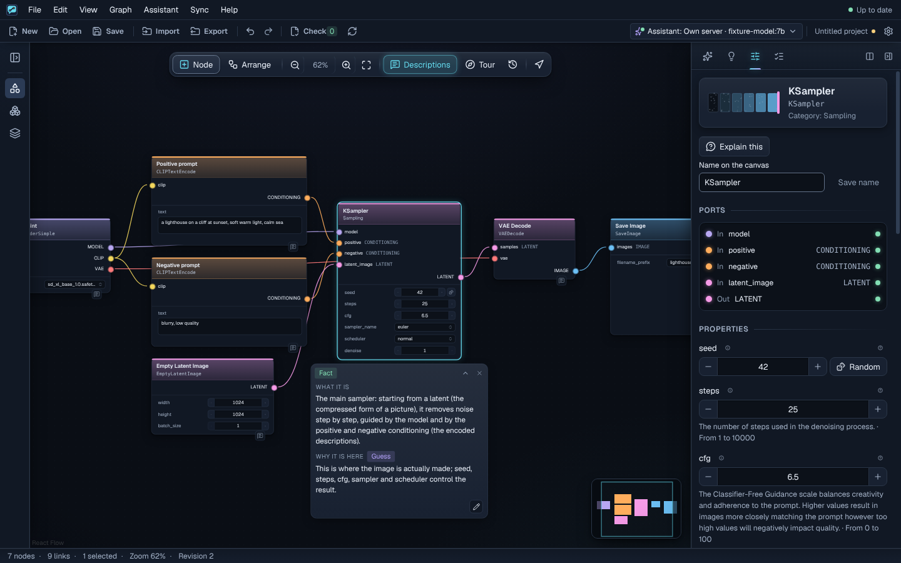

Русская версия: [README.ru.md](README.ru.md)

# NodeWise Studio

**A desktop tutor for ComfyUI graphs**

[](https://github.com/ZoriyAI/nodewise-studio/actions/workflows/ci.yml)
[](https://github.com/ZoriyAI/nodewise-studio/releases/latest)
[](LICENSE)


NodeWise Studio helps you learn ComfyUI and understand its graphs: it reads a running ComfyUI, explains every node and
link, teaches with lessons you do by hand, and has an assistant that explains and builds step by step. It is for
people new to ComfyUI and for anyone who wants to know why a graph works. It only reads ComfyUI and never changes it.

NodeWise is an independent, experimental learning tool. It is not affiliated with or endorsed by Comfy Org. It
contains no ComfyUI code and only reads a running ComfyUI; it never changes it.

## Screenshots

| | |
| --- | --- |
| [](docs/screenshots/en/02-canvas-explained.png) | [](docs/screenshots/en/07-lesson-step.png) |
| [](docs/screenshots/en/05-assistant-build.png) | [](docs/screenshots/en/08-check.png) |

[All screenshots](docs/screenshots/README.md)

## What it does

- **Reads your ComfyUI** at its address: nodes, packs and model files, with an optional MCP server for more.
  [Connecting](docs/wiki/connect/README.md)
- **A canvas for ComfyUI graphs**: real fields, typed links, subgraphs, groups, copy and paste, undo and redo.
  [Working with a graph](docs/wiki/graph/README.md)
- **Explains** every node, input, output and link, and says where each explanation comes from.
  [The window](docs/wiki/interface/README.md)
- **About eighty lessons** in twelve groups you do by hand on the real canvas, checked step by step, no AI model
  needed.
  [Lessons](docs/wiki/lessons/README.md)
- **An assistant** that asks, builds or teaches, with a cloud model and your key or a model on your own computer.
  [The assistant](docs/wiki/assistant/README.md)
- **Checks a graph** before you save it, and saves an ordinary workflow you run in ComfyUI.
  [Checking a graph](docs/wiki/graph/Checking-A-Graph.md)

## Install

### Linux

64-bit x86. Download from the [Releases](../../releases) page the format that suits your system:

| Format | Install |
| --- | --- |
| `.deb` (Ubuntu, Debian, Mint) | `sudo apt install ./nodewise-studio_*_amd64.deb` |
| `.rpm` (Fedora, openSUSE) | `sudo dnf install ./nodewise-studio-*.rpm` |
| AppImage | `chmod +x` the file, then open it |
| `.tar.gz` | unpack, then `./install.sh` (for your user, no root) or `./run.sh` (in place) |

Each release has a `SHA256SUMS` file: `sha256sum -c SHA256SUMS --ignore-missing`. Updating, removing, and what goes
where: [Installing](docs/wiki/start/Installing.md).

### Windows 10 22H2 and 11 (x64)

> **Not yet tried on a range of real computers:** see the note under the macOS lines below.

There is no Windows package yet. A script from the release builds the app on your computer from this project's source
and installs it for your user, without administrator rights. In PowerShell:

```powershell
Invoke-WebRequest -UseBasicParsing https://github.com/ZoriyAI/nodewise-studio/releases/latest/download/install-windows.ps1 -OutFile install-windows.ps1
powershell -NoProfile -ExecutionPolicy Bypass -File .\install-windows.ps1
```

`-ExecutionPolicy Bypass` applies to that one PowerShell process only. Add `-DryRun` to see every step first. What
it does, what it asks, how to remove the app: [Installing on Windows](docs/wiki/start/Installing-On-Windows.md).

### macOS 13 or newer (Apple silicon or Intel)

There is no macOS package yet. A script from the release builds the app on your Mac from this project's source and
installs it in `~/Applications`. In Terminal:

```bash
curl -fsSL https://github.com/ZoriyAI/nodewise-studio/releases/latest/download/install-macos.sh -o install-macos.sh && bash install-macos.sh
```

Add `--dry-run` to see every step first. What it does, what it asks, how to remove the app:
[Installing on macOS](docs/wiki/start/Installing-On-macOS.md).

The app is not signed by a publisher on Windows or macOS.

> **Checked on GitHub's machines, not yet on real computers.** Every change runs the Windows and macOS scripts on
> GitHub's Windows and macOS machines, where they build, install, start, upgrade and remove the app. They have not yet
> been tried on a range of real computers: if you try one, please
> [report what happened](https://github.com/ZoriyAI/nodewise-studio/issues) with the log file the script names at the end
> (`%TEMP%\nodewise-studio-install.log` or `~/Library/Logs/nodewise-studio-install.log`) and your system version. The
> Linux packages are built, installed and started on the build server for every release.

## First steps

1. Start ComfyUI. No ComfyUI yet? [ComfyUI and where to get it](docs/wiki/start/ComfyUI.md).
2. In NodeWise: Settings ▸ Connection, enter the address you open ComfyUI at in the browser (for example
   `http://127.0.0.1:8188`) or choose Find on this computer, save, and read it.
   [Connecting to ComfyUI](docs/wiki/connect/Connecting.md)
3. Open the right panel, choose Learn and take the first lesson. [Quick start](docs/wiki/start/Quick-Start.md)

## Documentation

| Chapter | What is in it |
| --- | --- |
| [Start](docs/wiki/start/README.md) | What the app is, installing, the first hour, updating and removing. |
| [Connecting](docs/wiki/connect/README.md) | Connecting the app to ComfyUI, on this computer or another. |
| [The window](docs/wiki/interface/README.md) | One page per part of the window. |
| [Working with a graph](docs/wiki/graph/README.md) | Building, checking, saving and running a graph. |
| [The assistant](docs/wiki/assistant/README.md) | Ask, Build, Learn, who answers and what is sent. |
| [Lessons](docs/wiki/lessons/README.md) | The built-in lessons, grouped by topic. |
| [ComfyUI concepts](docs/wiki/concepts/README.md) | An encyclopedia of ComfyUI for a newcomer. |
| [Reference](docs/wiki/reference/README.md) | Settings, shortcuts, messages, file formats, the glossary, troubleshooting. |
| [Trust](docs/wiki/trust/README.md) | Privacy, security, the licence, subject choice and accessibility. |
| [For developers](docs/wiki/dev/README.md) | How the code works, how to change it, how a release is made. |

The same documentation is in the app: Help ▸ User guide.

## Build from source

On Linux: [Building from source](docs/wiki/dev/Building-From-Source.md). On Windows and macOS, the steps the install
scripts take, by hand: [Windows](docs/wiki/dev/Building-On-Windows.md), [macOS](docs/wiki/dev/Building-On-macOS.md).

## What works today and known limits

NodeWise is experimental: things change between versions and some parts are unfinished. What it does not do yet:
[Known limitations](docs/wiki/reference/Known-Limits.md). What changed: [CHANGELOG.md](CHANGELOG.md).

It never installs, downloads, deletes, writes or queues anything in ComfyUI, has no telemetry and no crash
reporting, and asks about new versions only if you switch that on. Every place it can contact:
[Privacy](docs/wiki/trust/Privacy.md).

## Wishes, questions, problems

- Ideas, wishes and questions: [Discussions](../../discussions).
- Problems: [Issues](../../issues) (Help ▸ Report a problem in the app fills in the versions).
- A security problem: privately, see [SECURITY.md](SECURITY.md).
- Code: [CONTRIBUTING.md](CONTRIBUTING.md); everyone follows the [Code of Conduct](CODE_OF_CONDUCT.md).

## Who makes it

NodeWise Studio is made by Aleksey Ponomarenko, an independent developer who experiments in the field of AI
development. The app is one of those experiments: can a program teach ComfyUI by explaining your own graph, and how
far can one developer take a real desktop product when AI agents do much of the engineering under his direction?
Most of the code and the texts were written by AI coding agents, directed and reviewed by him, and he answers for
everything published here. More, with the principles the app keeps:
[The author and the experiment](docs/wiki/trust/Author.md).

## Licence

MIT with the Commons Clause condition: you may use, change and share NodeWise for free, but not sell it or a product
or service whose value comes mainly from it. It is source-available, not open source in the usual sense.
[LICENSE](LICENSE), [the licence in plain words](docs/wiki/trust/Licence.md), commercial use:
[COMMERCIAL.md](COMMERCIAL.md). Third-party components: [THIRD_PARTY_NOTICES.md](THIRD_PARTY_NOTICES.md).

Subject choice and adult education: [Content rules](docs/wiki/trust/Content-Rules.md).
