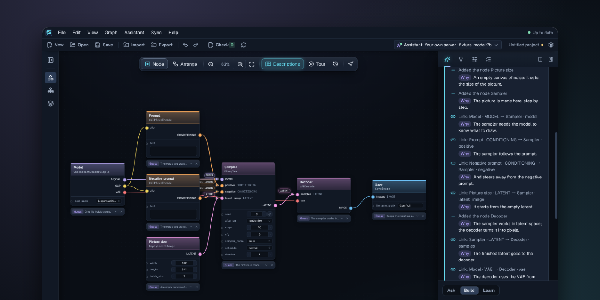
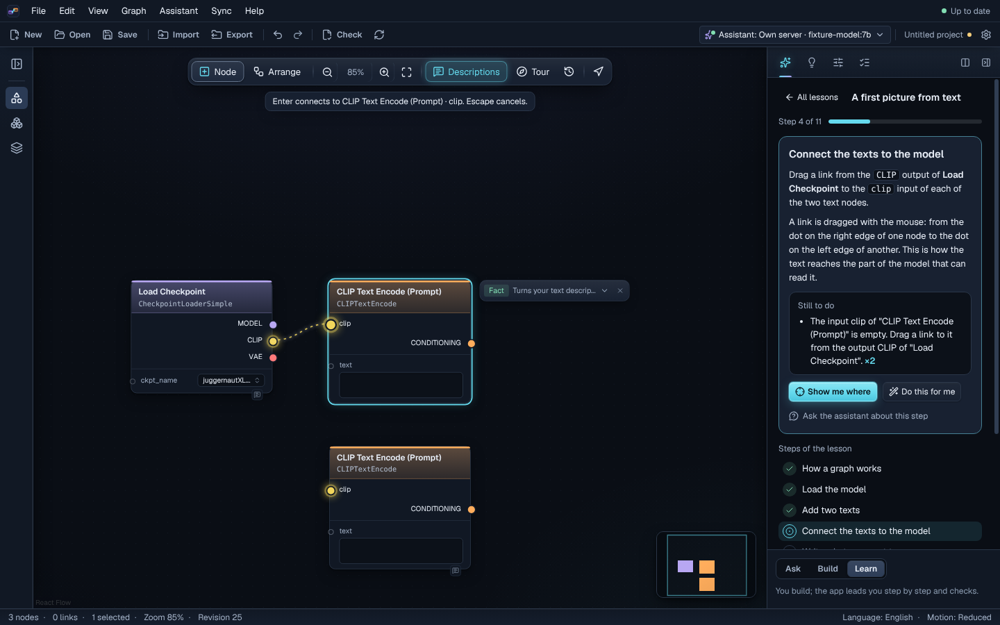
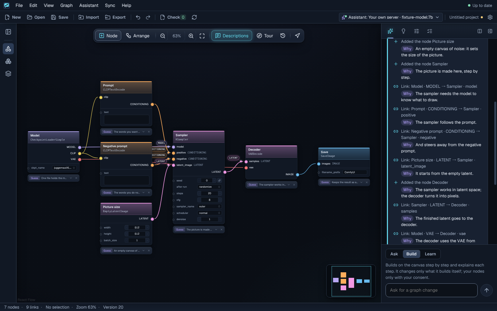
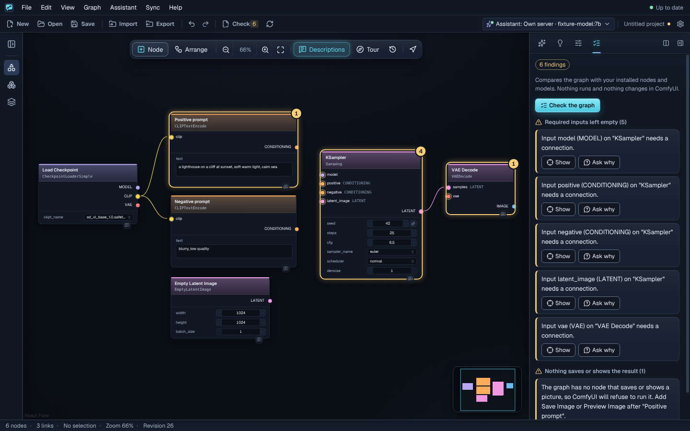
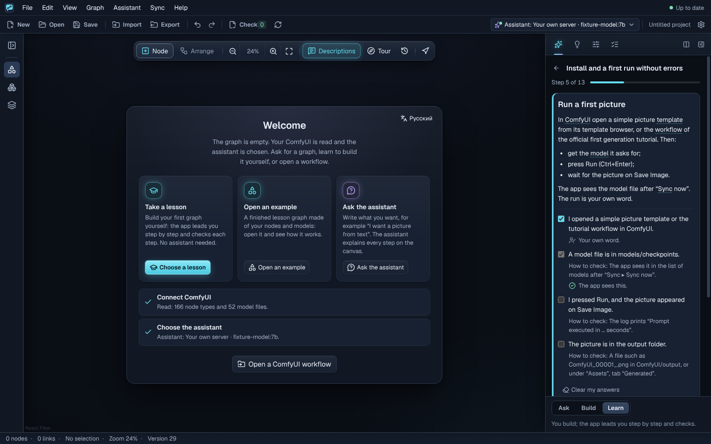
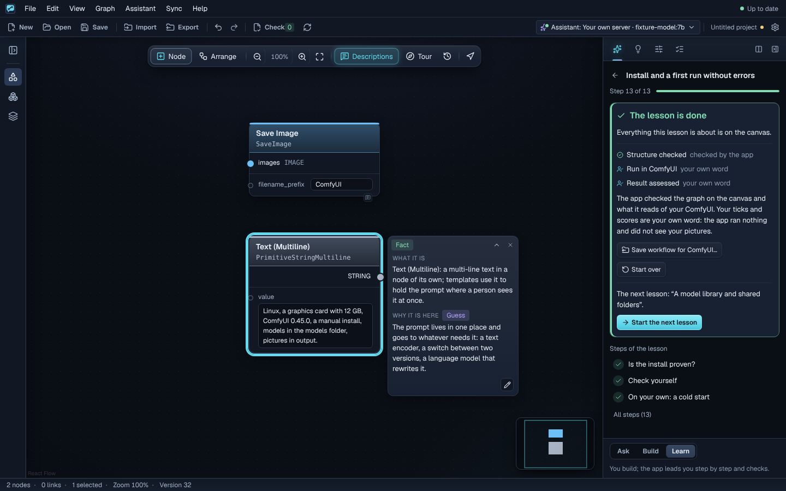

Русская версия: [README.ru.md](README.ru.md)

# NodeWise Studio

**Create with AI, explore your options and learn ComfyUI by doing**

[](https://github.com/ZoriyAI/nodewise-studio/actions/workflows/ci.yml)
[](https://github.com/ZoriyAI/nodewise-studio/releases/latest)
[](LICENSE)

NodeWise Studio is a visual workspace for ComfyUI. Choose a task, start from a template or your own workflow, configure its nodes, and save the result to run in ComfyUI. Wizards and explanations guide you through each step; a configured AI assistant can build and edit the graph when you ask.

NodeWise teaches, recommends and explains. It helps you choose a starting workflow, understand dependencies and compare ways forward. You can accept, change or skip a recommendation; you decide what to create and how.

Work on the desktop or open its interface in a phone or tablet browser over Wi-Fi. No separate mobile app is needed. Lessons, manual editing and wizards work without an AI model.

**[Download the latest release](https://github.com/ZoriyAI/nodewise-studio/releases/latest)** · **[Quick start](docs/wiki/start/Quick-Start.md)** · **[New in 1.4.0](docs/releases/v1.4.0.md)** · **[Phone and tablet access](docs/wiki/start/Browser-Access.md)**

NodeWise is an independent, experimental project, unaffiliated with Comfy Org. It reads the running ComfyUI catalog and uploads media you explicitly select to its input folder. Generation runs in ComfyUI after workflow export.

## Screenshots



| | |
| --- | --- |
| [](docs/screenshots/en/02-canvas-explained.png) | [](docs/screenshots/en/07-lesson-step.png) |
| [](docs/screenshots/en/05-assistant-build.png) | [](docs/screenshots/en/08-check.png) |
| [](docs/screenshots/en/15-lesson-checklist.png) | [](docs/screenshots/en/16-lesson-outcomes.png) |

[All screenshots](docs/screenshots/README.md)

## What you can do

| Your goal | How NodeWise helps |
| --- | --- |
| Start with an image, video, audio, 3D or text task | [Task wizards](docs/wiki/graph/Task-Wizards.md) and 115 bundled official blueprints from a pinned ComfyUI catalog revision, with required models and extensions listed. |
| Understand an existing workflow | Import nodes, links and settings; inspect node, port and connection explanations; check before exporting. [Working with a graph](docs/wiki/graph/README.md) |
| Make a reusable node | The [subgraph constructor](docs/wiki/graph/Subgraphs.md) lets you choose inputs, outputs and exposed controls, then edit the graph inside. |
| Ask AI for help | The [assistant](docs/wiki/assistant/Assistant.md) carries out ordinary requests: build variants, edit an existing graph or clear the canvas with undo. Explain mode leaves the graph unchanged. |
| Work through a problem | 50 guided routes with preparation, concrete actions and result checks; [the problem list and coverage](docs/research/2026-11-16-fifty-user-problems.md) are documented in Russian. |
| Understand installed models | A model and LoRA catalog, metadata, trigger words and descriptions; [Sync → Problems and repair](docs/wiki/interface/Sync-Menu.md). Russian description translation uses your configured assistant. |
| Use a phone or tablet | [Wi-Fi browser access](docs/wiki/start/Browser-Access.md), the device's own file picker, touch node menus, panel switching and undo. |
| Prepare classroom materials | [Six editable material types](docs/wiki/start/Classroom-Materials.md), optional assistant drafting, pupil/teacher sheets and files to adapt with colleagues. |
| Check this computer before ComfyUI | [Processor, RAM, graphics memory and disk space](docs/wiki/start/Computer.md), explained starting points and official setup guides. |
| Learn or teach | [95 lessons](docs/wiki/lessons/README.md) in 16 groups with step checks, your own lessons and files to share with students. |
| Prepare a ComfyUI run | Graph and dependency checks, resource estimates, workflow export and [releasing assistant model memory](docs/wiki/graph/Running-In-ComfyUI.md). |

Choose a local model through Ollama, LM Studio, llama.cpp or a compatible server, or connect a cloud provider with your own key. [Choosing an assistant](docs/wiki/assistant/Choosing-Who-Answers.md).

Structure checks and memory estimates help prepare a run; you assess the actual image or video in ComfyUI. Review assistant-generated extension code before installing it.

## Install

### Linux

On Ubuntu, Debian or Mint, download the `.deb` and open it with the software installer. To update, install the new package; saved projects and settings stay in the data folder. Other formats and terminal commands are below.

64-bit x86. Download from the [Releases](https://github.com/ZoriyAI/nodewise-studio/releases/latest) page the format that suits your system:

| Format | Install |
| --- | --- |
| `.deb` (Ubuntu, Debian, Mint) | `sudo apt install ./nodewise-studio_*_amd64.deb` |
| `.rpm` (Fedora) | `sudo dnf install ./nodewise-studio-*.rpm` |
| `.rpm` (openSUSE) | `sudo zypper install ./nodewise-studio-*.rpm` |
| AppImage | `chmod +x` the file, then open it |
| `.tar.gz` | unpack, then `./install.sh` (for your user, no root) or `./run.sh` (in place) |

Each release has a `SHA256SUMS` file: `sha256sum -c SHA256SUMS --ignore-missing`. Updating, removing, and what goes
where: [Installing](docs/wiki/start/Installing.md).

### Windows 10 22H2 and 11 (x64)

There is no Windows package yet. A script from the release builds the app on your computer from this project's source
and installs it for your user, without administrator rights. In PowerShell:

```powershell
Invoke-WebRequest -UseBasicParsing https://github.com/ZoriyAI/nodewise-studio/releases/latest/download/install-windows.ps1 -OutFile install-windows.ps1
powershell -NoProfile -ExecutionPolicy Bypass -File .\install-windows.ps1
```

`-ExecutionPolicy Bypass` applies to that one PowerShell process only. Add `-DryRun` to see every step first. What
it does, what it asks, how to remove the app: [Installing on Windows](docs/wiki/start/Installing-On-Windows.md).

### macOS 13 or newer (Apple silicon or Intel)

There is no macOS package yet. A script from the release builds the app on your Mac from this project's source and
installs it in `~/Applications`. In Terminal:

```bash
curl -fsSL https://github.com/ZoriyAI/nodewise-studio/releases/latest/download/install-macos.sh -o install-macos.sh && bash install-macos.sh
```

Add `--dry-run` to see every step first. What it does, what it asks, how to remove the app:
[Installing on macOS](docs/wiki/start/Installing-On-macOS.md).

The app is not signed by a publisher on Windows or macOS.

> **Checked on GitHub's machines, not yet on real computers.** Every change runs the Windows and macOS scripts on
> GitHub's Windows and macOS machines, where they build, install, start, upgrade and remove the app. They have not yet
> been tried on a range of real computers: if you try one, please
> [report what happened](https://github.com/ZoriyAI/nodewise-studio/issues) with the log file the script names at the end
> (`%TEMP%\nodewise-studio-install.log` or `~/Library/Logs/nodewise-studio-install.log`) and your system version. The
> Linux packages are built, installed and started on the build server for every release.

## First steps

1. Install NodeWise from the [latest release](https://github.com/ZoriyAI/nodewise-studio/releases/latest) and start ComfyUI. [Getting ComfyUI](docs/wiki/start/ComfyUI.md).
2. In **Settings → Connection**, choose **Find on this computer** or enter the ComfyUI address, save it and synchronize. [Connecting](docs/wiki/connect/Connecting.md).
3. Choose **Task wizards** for a result of your own, **Learn** for a lesson, or open an existing workflow. You can configure an assistant later.
4. Check the graph and choose **Save workflow for ComfyUI**. Open the saved file in ComfyUI and run it there. [A first result, step by step](docs/wiki/start/Quick-Start.md).

### From a phone or tablet

On the computer, open **Settings → Browser access**, enable access and save the address and port. On a device in the same network, open the displayed address or QR code and enter the code from **Connect a device**. Keep the desktop app running. [Full instructions](docs/wiki/start/Browser-Access.md).

## Documentation

| Chapter | What is in it |
| --- | --- |
| [Start](docs/wiki/start/README.md) | What the app is, installing, the first hour, updating and removing. |
| [Connecting](docs/wiki/connect/README.md) | Connecting the app to ComfyUI, on this computer or another. |
| [The window](docs/wiki/interface/README.md) | One page per part of the window. |
| [Working with a graph](docs/wiki/graph/README.md) | Building, checking, saving and running a graph. |
| [The assistant](docs/wiki/assistant/README.md) | Assistant, Explain, Build and Learn; model choice and sent data. |
| [Lessons](docs/wiki/lessons/README.md) | The built-in lessons, grouped by topic. |
| [ComfyUI concepts](docs/wiki/concepts/README.md) | An encyclopedia of ComfyUI for a newcomer. |
| [Reference](docs/wiki/reference/README.md) | Settings, shortcuts, messages, file formats, the glossary, troubleshooting. |
| [Trust](docs/wiki/trust/README.md) | Privacy, security, the licence, subject choice and accessibility. |
| [For developers](docs/wiki/dev/README.md) | How the code works, how to change it, how a release is made. |

The same documentation is in the app: Help ▸ User guide.

## Build from source

For **1.4.0** source, use [tag v1.4.0](https://github.com/ZoriyAI/nodewise-studio/tree/v1.4.0) or the source archive on the release page. The `main` branch can differ from the published application; this documentation describes the release.

On Linux: [Building from source](docs/wiki/dev/Building-From-Source.md). On Windows and macOS, the steps the install
scripts take, by hand: [Windows](docs/wiki/dev/Building-On-Windows.md), [macOS](docs/wiki/dev/Building-On-macOS.md).

## What works today and known limits

NodeWise is experimental: things change between versions and some parts are unfinished. What it does not do yet:
[Known limitations](docs/wiki/reference/Known-Limits.md). What changed: [CHANGELOG.md](CHANGELOG.md).

Catalog reads leave ComfyUI files unchanged. Media you select is uploaded to input; models and extensions are not installed automatically, and you run the graph in ComfyUI. There is no telemetry or automatic crash reporting. External connections and data handling are described in [Privacy](docs/wiki/trust/Privacy.md).

## Wishes, questions, problems

- Ideas, wishes and questions: [Discussions](https://github.com/ZoriyAI/nodewise-studio/discussions).
- Problems: [Issues](https://github.com/ZoriyAI/nodewise-studio/issues) (Help ▸ Report a problem in the app fills in the versions).
- A security problem: privately, see [SECURITY.md](SECURITY.md).
- Taking part: the project welcomes ideas, reports and tests, but does not merge pull requests with code; why, and
  what helps most: [CONTRIBUTING.md](CONTRIBUTING.md). Everyone follows the [Code of Conduct](CODE_OF_CONDUCT.md).

## Who makes it

NodeWise Studio is made by Aleksey Ponomarenko, an independent developer who experiments in the field of AI
development. The app is one of those experiments: can a program teach ComfyUI by explaining your own graph, and how
far can one developer take a real desktop product when AI agents do much of the engineering under his direction?
Most of the code and the texts were written by AI coding agents, directed and reviewed by him, and he answers for
everything published here. He keeps the rights to all of the code in one hand, so the project takes no code from
outside ([CONTRIBUTING.md](CONTRIBUTING.md)). More, with the principles the app keeps:
[The author and the experiment](docs/wiki/trust/Author.md).

## Licence

MIT with the Commons Clause condition: you may use, change and share NodeWise for free, but not sell it or a product
or service whose value comes mainly from it. It is source-available, not open source in the usual sense.
[LICENSE](LICENSE), [the licence in plain words](docs/wiki/trust/Licence.md), commercial use:
[COMMERCIAL.md](COMMERCIAL.md). Third-party components: [THIRD_PARTY_NOTICES.md](THIRD_PARTY_NOTICES.md).

Copyright © 2026 Aleksey Ponomarenko (ZoriyAI), the sole author and copyright holder; all rights are reserved except
the permissions the licence grants. Selling it, or a paid product or service built mainly on it, without his written
permission breaches the licence; who holds what, and the dated record of every release: [NOTICE.md](NOTICE.md).

Subject choice and adult education: [Content rules](docs/wiki/trust/Content-Rules.md).
