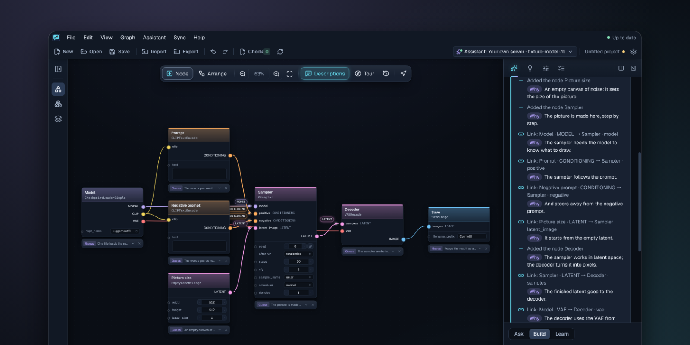
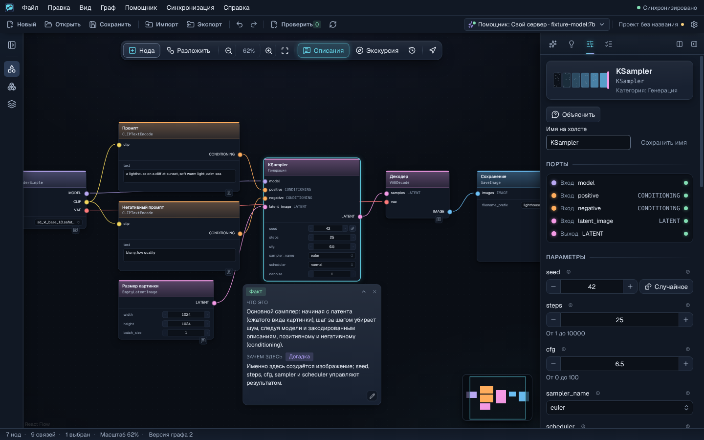
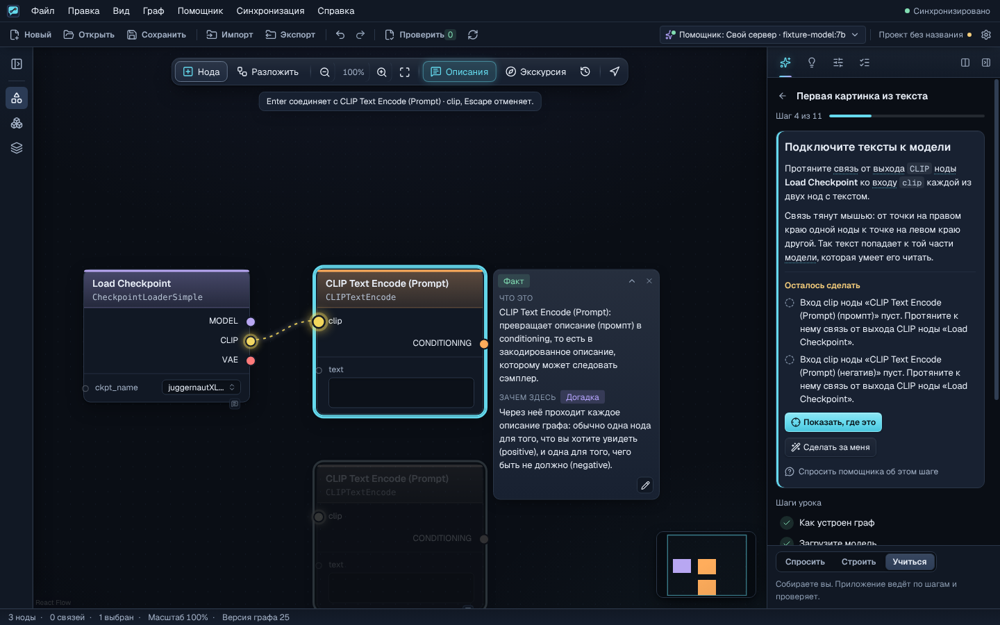
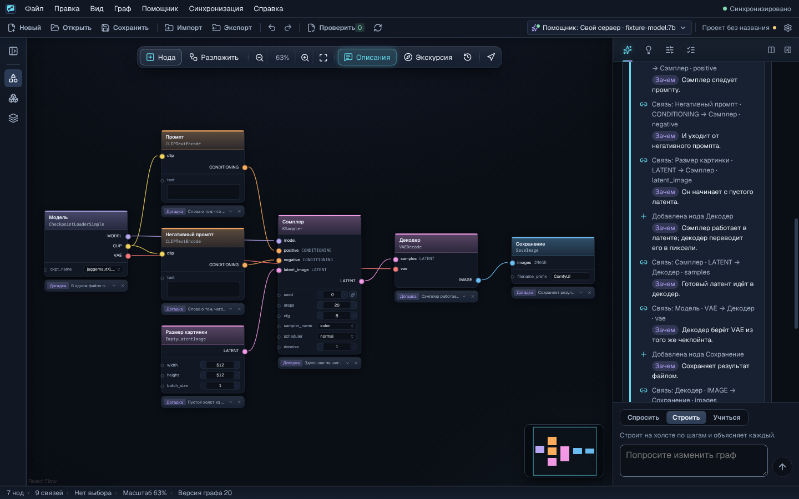
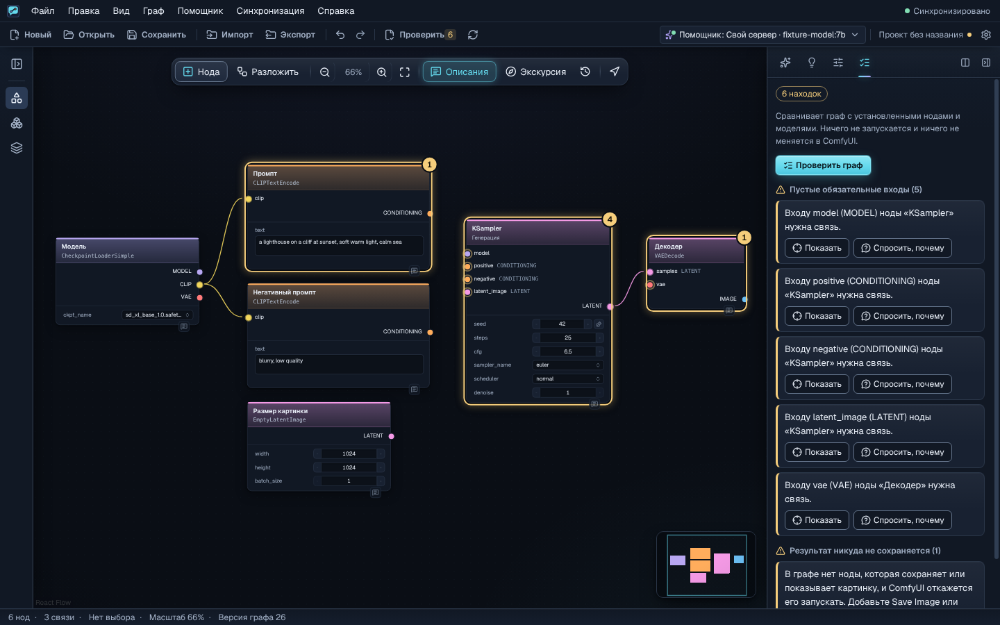
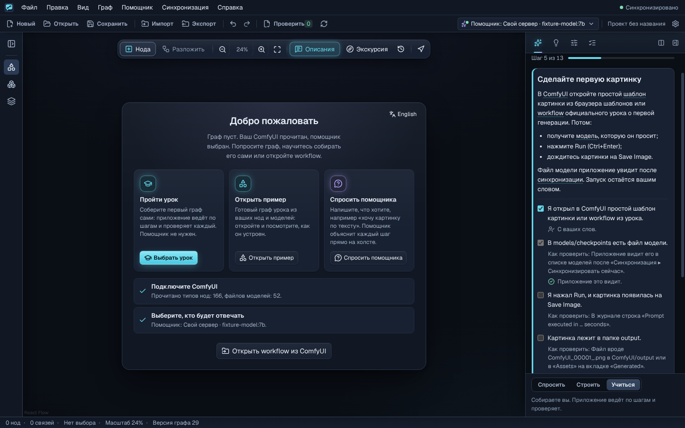
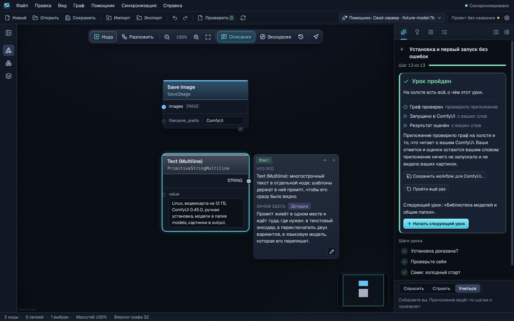

English version: [README.md](README.md)

# NodeWise Studio

**Создавайте графы ComfyUI, разбирайтесь в них и учитесь на практике**

[](https://github.com/ZoriyAI/nodewise-studio/actions/workflows/ci.yml)
[](https://github.com/ZoriyAI/nodewise-studio/releases/latest)
[](LICENSE)

NodeWise Studio — визуальная мастерская для ComfyUI. Выберите задачу, начните с готового шаблона или своего workflow, настройте ноды и сохраните результат для запуска в ComfyUI. Мастера и объяснения помогают идти по шагам; подключённый ИИ-помощник может собирать и менять граф по вашей просьбе.

Работайте на компьютере или откройте его интерфейс в браузере телефона и планшета через Wi-Fi. Отдельное мобильное приложение не нужно. Уроки, ручное редактирование и мастера доступны без модели ИИ.

**[Скачать актуальную версию](https://github.com/ZoriyAI/nodewise-studio/releases/latest)** · **[Быстрый старт](docs/wiki/start/Quick-Start.ru.md)** · **[Что нового в 1.3.0](docs/releases/v1.3.0.ru.md)** · **[Телефон и планшет](docs/wiki/start/Browser-Access.ru.md)**

NodeWise — независимый экспериментальный проект, не связанный с Comfy Org. Он читает каталог запущенного ComfyUI; выбранные вами медиафайлы загружает в его папку input. Генерация выполняется в ComfyUI после экспорта workflow.

## Снимки экрана



| | |
| --- | --- |
| [](docs/screenshots/ru/02-canvas-explained.png) | [](docs/screenshots/ru/07-lesson-step.png) |
| [](docs/screenshots/ru/05-assistant-build.png) | [](docs/screenshots/ru/08-check.png) |
| [](docs/screenshots/ru/15-lesson-checklist.png) | [](docs/screenshots/ru/16-lesson-outcomes.png) |

[Все снимки экрана](docs/screenshots/README.ru.md)

## Что можно сделать

| Ваша задача | Как помогает NodeWise |
| --- | --- |
| Начать с изображения, видео, звука, 3D или текста | [Мастера задач](docs/wiki/graph/Task-Wizards.ru.md) и 115 встроенных официальных blueprint-шаблонов из зафиксированной версии каталога ComfyUI. Видны необходимые модели и расширения. |
| Разобраться в чужом workflow | Импорт нод, связей и настроек; объяснения нод, портов и связей; проверка перед экспортом. [Работа с графом](docs/wiki/graph/README.ru.md) |
| Сделать свою составную ноду | [Конструктор субграфов](docs/wiki/graph/Subgraphs.ru.md): выбрать входы, выходы и настройки на внешней ноде, затем редактировать внутренний граф. |
| Попросить ИИ помочь | [Помощник](docs/wiki/assistant/Assistant.ru.md) выполняет обычные просьбы: собрать варианты, изменить существующий граф или очистить холст с возможностью отмены. Отдельный режим «Объяснить» оставляет граф без изменений. |
| Найти причину проблемы | 50 пошаговых маршрутов с подготовкой, конкретными действиями и проверкой результата; [список задач и покрытие](docs/research/2026-11-16-fifty-user-problems.md). |
| Понять, какие модели установлены | Каталог моделей и LoRA, метаданные, trigger-слова и описания; [«Синхронизация → Проблемы и исправление»](docs/wiki/interface/Sync-Menu.ru.md). Русский перевод описаний доступен с настроенным помощником. |
| Работать с телефона | [Доступ по Wi-Fi](docs/wiki/start/Browser-Access.ru.md), выбор файла на самом телефоне, сенсорные меню нод, переключение панелей и отмена действий. |
| Учиться или обучать других | [95 уроков](docs/wiki/lessons/README.ru.md) в 16 группах с проверкой шагов, свои уроки и экспорт материалов ученикам. |
| Подготовить запуск в ComfyUI | Проверка графа и зависимостей, оценка ресурсов, экспорт workflow и [освобождение памяти моделей помощника](docs/wiki/graph/Running-In-ComfyUI.ru.md). |

Можно выбрать локальную модель через Ollama, LM Studio, llama.cpp или совместимый сервер либо подключить облачного поставщика своим ключом. [Выбор помощника](docs/wiki/assistant/Choosing-Who-Answers.ru.md).

Проверка структуры и оценка памяти помогают подготовиться к запуску; фактический результат изображения или видео проверяется в ComfyUI. Расширения, созданные помощником, нужно просмотреть перед установкой.

## Установка

### Linux

Для Ubuntu, Debian и Mint скачайте `.deb` и откройте его в установщике программ. При обновлении установите новый пакет; сохранённые проекты и настройки остаются в папке данных. Другие форматы и команды ниже.

64 бита, x86. Скачайте со страницы [выпусков](https://github.com/ZoriyAI/nodewise-studio/releases/latest) формат для вашей системы:

| Формат | Установка |
| --- | --- |
| `.deb` (Ubuntu, Debian, Mint) | `sudo apt install ./nodewise-studio_*_amd64.deb` |
| `.rpm` (Fedora) | `sudo dnf install ./nodewise-studio-*.rpm` |
| `.rpm` (openSUSE) | `sudo zypper install ./nodewise-studio-*.rpm` |
| AppImage | `chmod +x` для файла, затем откройте его |
| `.tar.gz` | распакуйте, затем `./install.sh` (для вашего пользователя, без root) или `./run.sh` (на месте) |

У каждого выпуска есть файл `SHA256SUMS`: `sha256sum -c SHA256SUMS --ignore-missing`. Обновление, удаление и что
куда ставится: [Установка](docs/wiki/start/Installing.ru.md).

### Windows 10 22H2 и 11 (x64)

Пакета для Windows пока нет. Скрипт из выпуска собирает приложение на вашем компьютере из исходного кода этого
проекта и ставит его для вашего пользователя, без прав администратора. В PowerShell:

```powershell
Invoke-WebRequest -UseBasicParsing https://github.com/ZoriyAI/nodewise-studio/releases/latest/download/install-windows.ps1 -OutFile install-windows.ps1
powershell -NoProfile -ExecutionPolicy Bypass -File .\install-windows.ps1
```

`-ExecutionPolicy Bypass` действует только для этого одного процесса PowerShell. Добавьте `-DryRun`, чтобы сначала
увидеть все шаги. Что скрипт делает, о чём спрашивает и как удалить приложение:
[Установка на Windows](docs/wiki/start/Installing-On-Windows.ru.md).

### macOS 13 или новее (Apple silicon или Intel)

Пакета для macOS пока нет. Скрипт из выпуска собирает приложение на вашем Mac из исходного кода этого проекта и ставит
его в `~/Applications`. В Терминале:

```bash
curl -fsSL https://github.com/ZoriyAI/nodewise-studio/releases/latest/download/install-macos.sh -o install-macos.sh && bash install-macos.sh
```

Добавьте `--dry-run`, чтобы сначала увидеть все шаги. Что скрипт делает, о чём спрашивает и как удалить приложение:
[Установка на macOS](docs/wiki/start/Installing-On-macOS.ru.md).

Ни на Windows, ни на macOS приложение не подписано издателем.

> **Проверено на машинах GitHub, на настоящих компьютерах ещё нет.** При каждом изменении скрипты для Windows и
> macOS запускаются на машинах GitHub с Windows и macOS, где они собирают, ставят, запускают, обновляют и удаляют
> приложение. На разных настоящих компьютерах их ещё не пробовали: если попробуете, пожалуйста,
> [сообщите, что получилось](https://github.com/ZoriyAI/nodewise-studio/issues), приложив файл журнала, который скрипт
> назовёт в конце (`%TEMP%\nodewise-studio-install.log` или `~/Library/Logs/nodewise-studio-install.log`), и версию
> системы. Пакеты для Linux для каждого выпуска собираются, устанавливаются и запускаются на сервере сборки.

## Первые шаги

1. Установите NodeWise из [актуального выпуска](https://github.com/ZoriyAI/nodewise-studio/releases/latest) и запустите ComfyUI. [Где взять ComfyUI](docs/wiki/start/ComfyUI.ru.md).
2. В «Настройки → Подключение» нажмите «Найти на этом компьютере» или укажите адрес ComfyUI, сохраните его и выполните синхронизацию. [Подключение](docs/wiki/connect/Connecting.ru.md).
3. Выберите удобный вход: **«Мастера задач»** для своего результата, **«Учиться»** для урока или откройте готовый workflow. Помощника можно подключить позже.
4. Проверьте граф и выберите **«Сохранить workflow для ComfyUI»**. Откройте полученный файл в ComfyUI и запустите там. [Пошаговый первый результат](docs/wiki/start/Quick-Start.ru.md).

### С телефона или планшета

На компьютере откройте **«Настройки → Доступ по сети»**, включите доступ и сохраните адрес и порт. На устройстве в той же сети откройте показанный адрес или QR-код, затем введите код из **«Подключить устройство»**. Приложение на компьютере должно оставаться запущенным. [Полная инструкция](docs/wiki/start/Browser-Access.ru.md).

## Документация

| Глава | Что в ней |
| --- | --- |
| [Начало](docs/wiki/start/README.ru.md) | Что это за приложение, установка, первый час, обновление и удаление. |
| [Подключение](docs/wiki/connect/README.ru.md) | Как подключить приложение к ComfyUI на этом или другом компьютере. |
| [Окно приложения](docs/wiki/interface/README.ru.md) | По странице на каждую часть окна. |
| [Работа с графом](docs/wiki/graph/README.ru.md) | Как собрать, проверить, сохранить и запустить граф. |
| [Помощник](docs/wiki/assistant/README.ru.md) | Помощник, Объяснить, Строить, Учиться; выбор модели и отправляемые данные. |
| [Уроки](docs/wiki/lessons/README.ru.md) | Встроенные уроки по темам. |
| [Понятия ComfyUI](docs/wiki/concepts/README.ru.md) | Энциклопедия ComfyUI для новичка. |
| [Справочник](docs/wiki/reference/README.ru.md) | Настройки, сочетания клавиш, сообщения, форматы файлов, словарь, решение проблем. |
| [Доверие](docs/wiki/trust/README.ru.md) | Приватность, безопасность, лицензия, выбор темы и доступность. |
| [Для разработчиков](docs/wiki/dev/README.ru.md) | Как устроен код, как его менять, как выходит версия. |

Та же документация есть в приложении: «Справка ▸ Руководство».

## Сборка из исходников

Для исходников **1.3.0** используйте [тег v1.3.0](https://github.com/ZoriyAI/nodewise-studio/tree/v1.3.0) или архив исходного кода на странице выпуска. Ветка `main` может отличаться от опубликованной программы; эта документация описывает выпуск.

В Linux: [Сборка из исходников](docs/wiki/dev/Building-From-Source.ru.md). На Windows и macOS те же шаги, что делают
скрипты установки, вручную: [Windows](docs/wiki/dev/Building-On-Windows.ru.md), [macOS](docs/wiki/dev/Building-On-macOS.ru.md).

## Что работает сегодня и известные ограничения

NodeWise экспериментальный: от версии к версии многое меняется, некоторые части не доделаны. Чего он пока не
умеет: [Известные ограничения](docs/wiki/reference/Known-Limits.ru.md). Что изменилось:
[CHANGELOG.ru.md](CHANGELOG.ru.md).

Чтение каталога не меняет файлы ComfyUI. Выбранные вами медиафайлы загружаются в input; модели и расширения не устанавливаются автоматически, граф запускаете вы в ComfyUI. Телеметрии и автоматических отчётов о сбоях нет. Все внешние подключения и работа с данными описаны в [правилах приватности](docs/wiki/trust/Privacy.ru.md).

## Пожелания, вопросы, проблемы

- Идеи, пожелания и вопросы: [обсуждения](https://github.com/ZoriyAI/nodewise-studio/discussions).
- Проблемы: [обращения](https://github.com/ZoriyAI/nodewise-studio/issues) («Справка ▸ Сообщить о проблеме…» в приложении впишет версии).
- Проблема безопасности: закрыто, см. [SECURITY.ru.md](SECURITY.ru.md).
- Участие: идеям, отчётам и проверкам проект рад, но pull request с кодом не принимает; почему и что помогает
  больше всего: [CONTRIBUTING.ru.md](CONTRIBUTING.ru.md). Все участники следуют [правилам поведения](CODE_OF_CONDUCT.ru.md).

## Кто это делает

NodeWise Studio делает Алексей Пономаренко, независимый разработчик, который экспериментирует в области разработки
с ИИ. Приложение один из этих экспериментов: может ли программа научить ComfyUI, объясняя ваш собственный граф, и как
далеко один разработчик может довести настоящее приложение для компьютера, если большую часть инженерной работы под
его руководством делают ИИ-агенты? Большую часть кода и текстов написали ИИ-агенты для программирования под
его руководством и с его проверкой, и за всё, что здесь опубликовано, отвечает он. Права на весь код он держит в одних руках, поэтому код со стороны проект не
принимает ([CONTRIBUTING.ru.md](CONTRIBUTING.ru.md)). Подробнее, вместе с принципами приложения:
[Автор и эксперимент](docs/wiki/trust/Author.ru.md).

## Лицензия

MIT с условием Commons Clause: NodeWise можно бесплатно использовать, менять и распространять, но нельзя продавать
его или продукт или услугу, ценность которых в основном в нём. Исходный код открыт для чтения, но это не «открытый
исходный код» в обычном смысле. [LICENSE](LICENSE), [лицензия простыми словами](docs/wiki/trust/Licence.ru.md),
коммерческое использование: [COMMERCIAL.ru.md](COMMERCIAL.ru.md). Сторонние компоненты:
[THIRD_PARTY_NOTICES.ru.md](THIRD_PARTY_NOTICES.ru.md).

Copyright © 2026 Алексей Пономаренко (ZoriyAI), единственный автор и правообладатель; все права защищены, кроме
разрешений, которые даёт лицензия. Продажа его или платного продукта или услуги, построенных в основном на нём, без
его письменного разрешения нарушает лицензию; кому что принадлежит и датированная запись версий:
[NOTICE.ru.md](NOTICE.ru.md).

Выбор темы и материалы для взрослых: [Правила содержимого](docs/wiki/trust/Content-Rules.ru.md).
