[Русский](README.ru.md)

# Screenshots

Every picture below is taken from the app itself by `npm run shots:public`, with test data only: a test ComfyUI
server and a scripted assistant, no real person's files. Window 1440 x 900.

## 01 First start

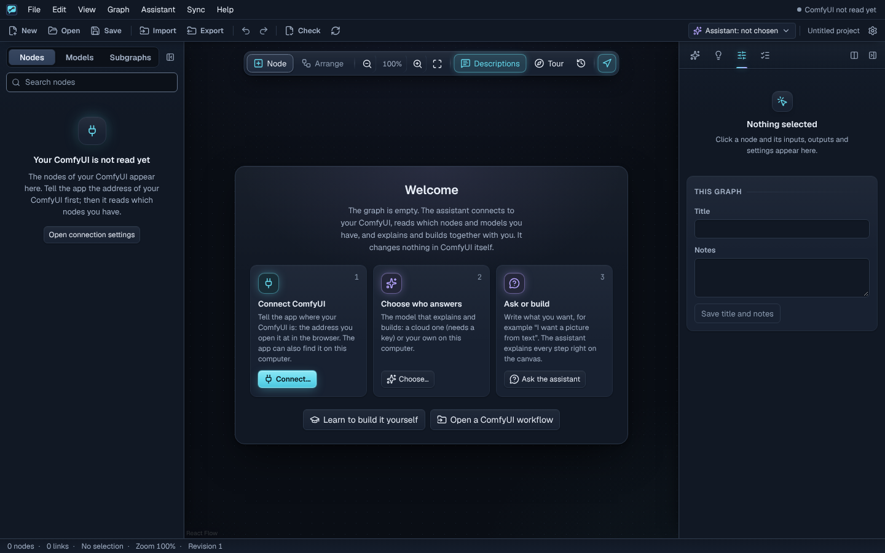

A new person sees three steps (connect ComfyUI, choose who answers, ask or build) and what each one needs.

## 02 A graph, explained

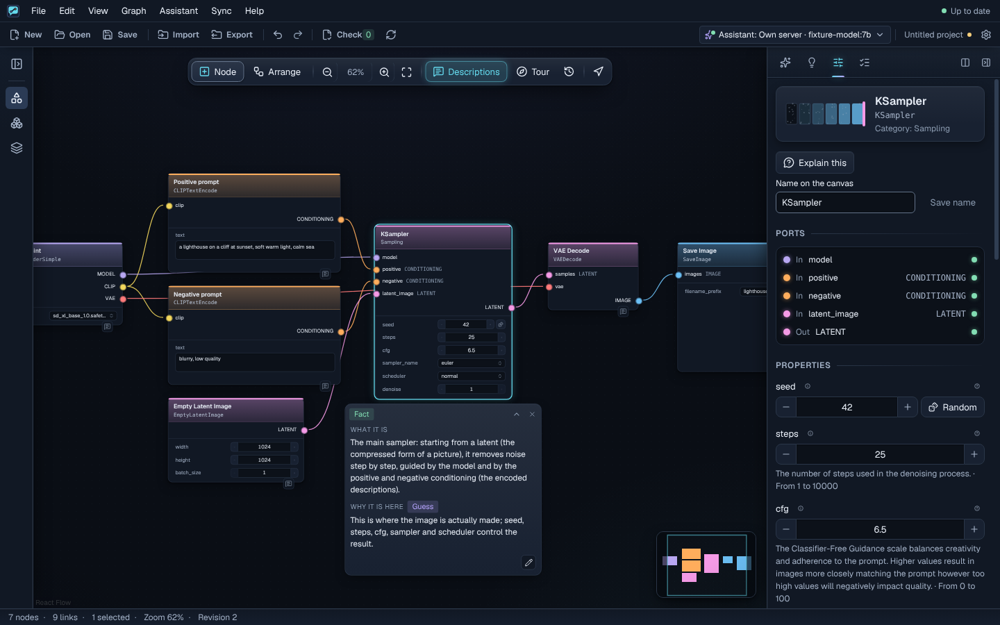

Select any node and the app says what it is, why it is there, and shows its inputs, outputs and settings.

## 03 Library

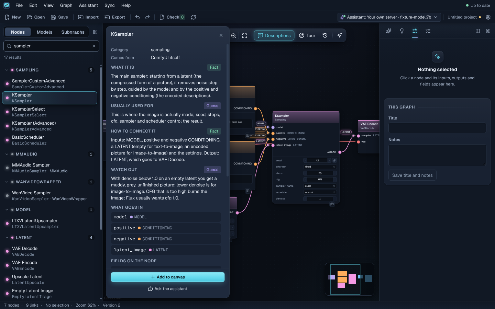

The library lists the nodes and models your ComfyUI really has; a card explains a node before you add it.

## 04 Ask the assistant

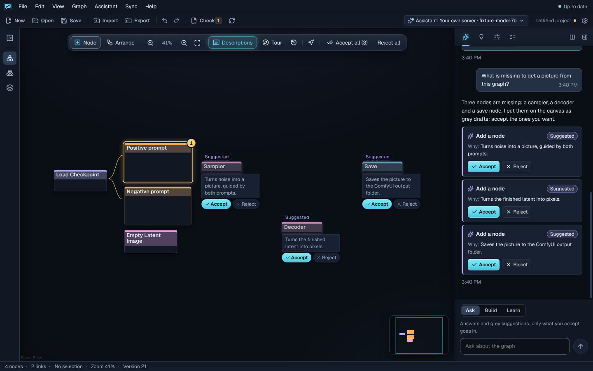

The assistant suggests nodes as grey drafts; nothing enters the graph until you accept it.

## 05 Build with the assistant

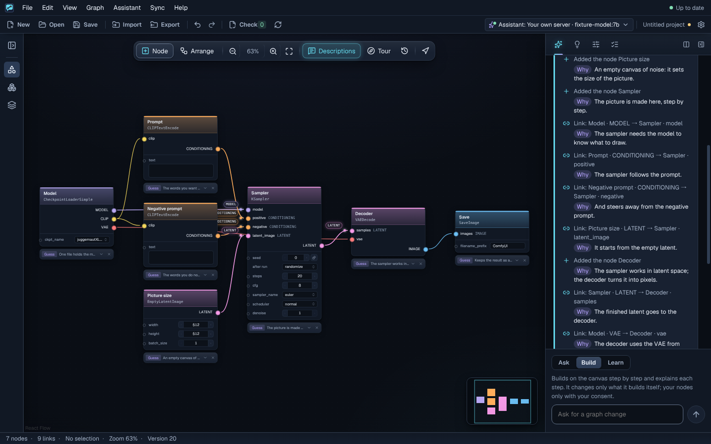

In Build mode the assistant adds one node or link at a time and says why for every step.

## 06 Lessons

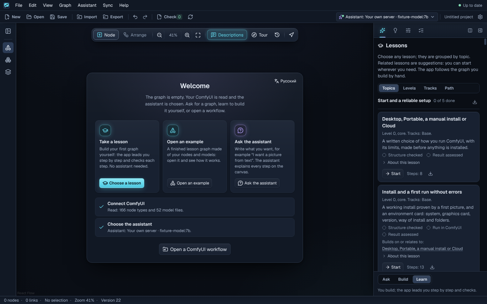

95 built-in lessons in sixteen groups need no model: you build by hand and the app checks each step on the canvas.
Each card says the lesson's level, its tracks and what it ends with.

## 07 A lesson step

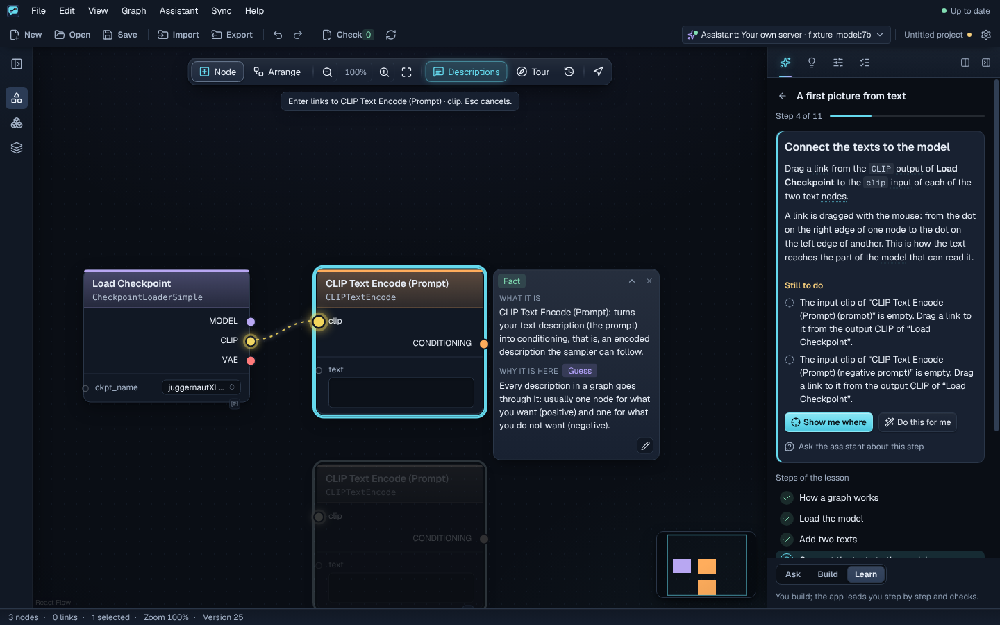

A step says what to do and why, and "Show me where" lights the exact output and input on the canvas.

## 08 Check

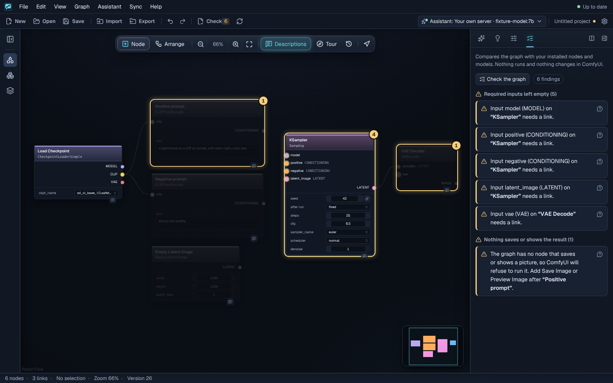

Check compares the graph with your installed nodes and models and says what is missing before you export.

## 09 Inside a subgraph

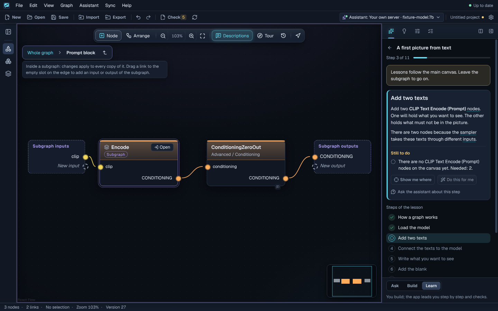

A subgraph opens on the canvas; its inputs and outputs are shown at the edges.

## 10 A large workflow

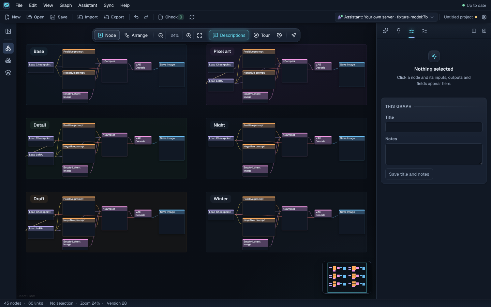

A large workflow is shown from above in readable blocks; zoom in to see every field.

## 11 Settings: connection

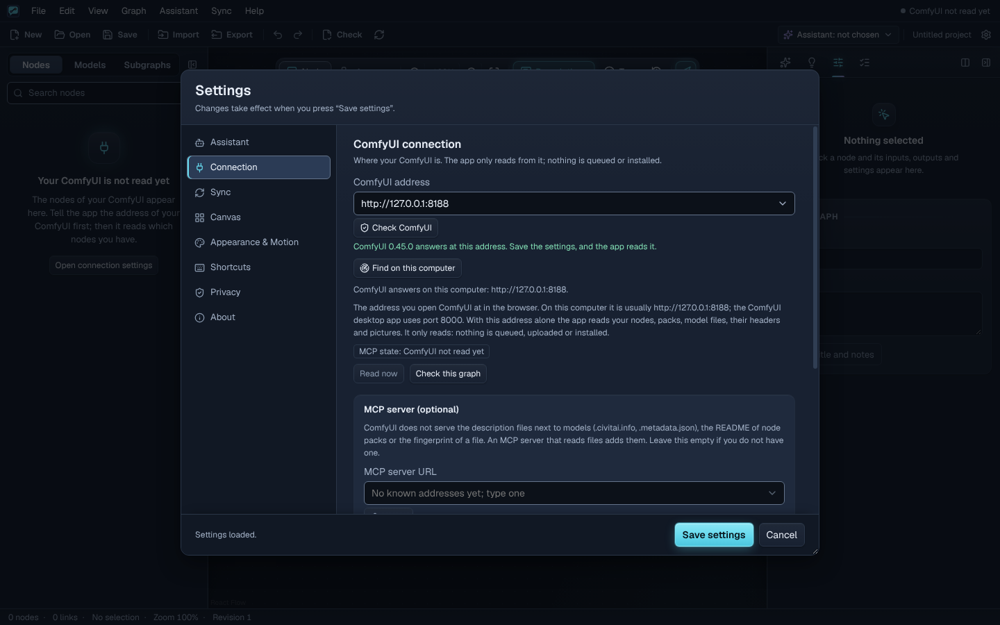

The app connects to ComfyUI read-only: nothing is installed, queued or changed there.

## 12 Settings: assistant

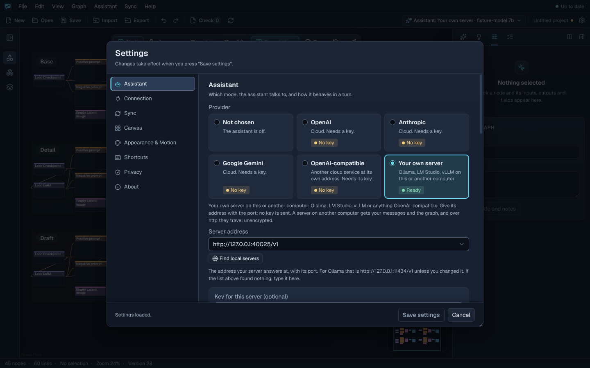

Choose a cloud model with your key or a model on your own computer; lessons work without either.

## 13 Help

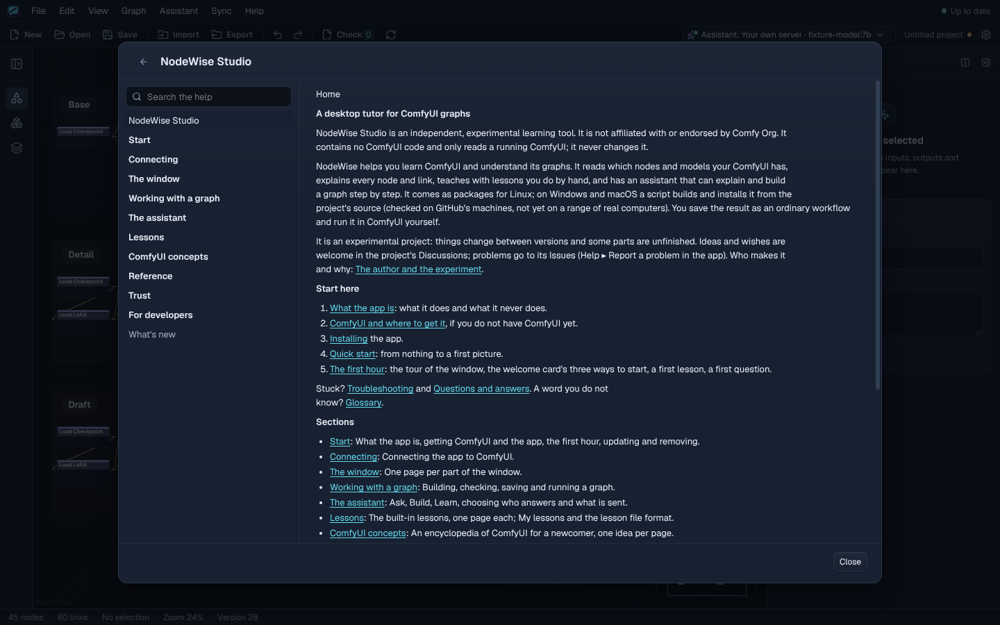

The user guide is built in and opens from the Help menu, also without the internet.

## 14 Lessons as a path

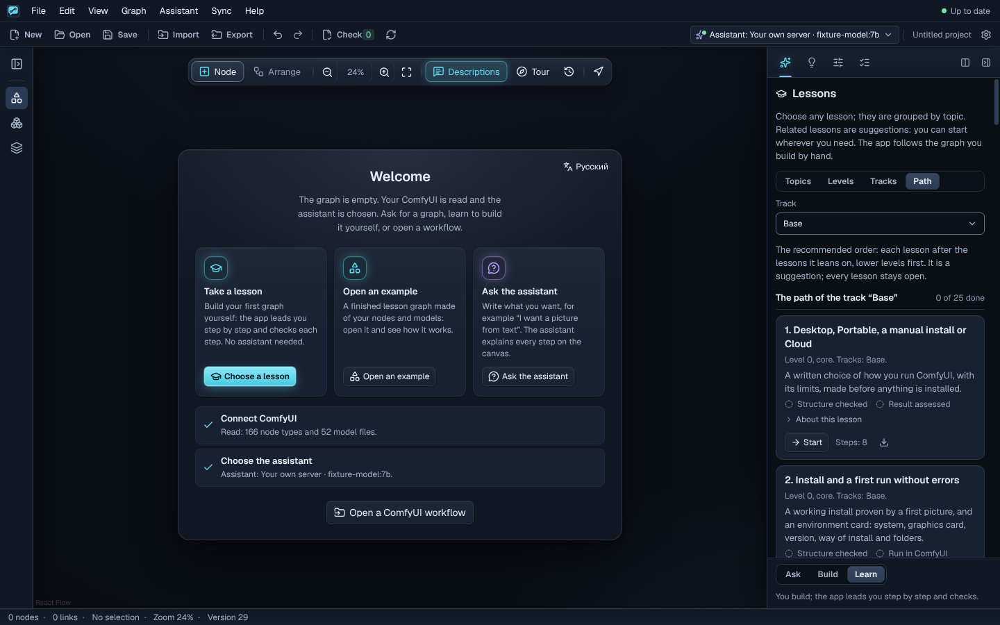

**Show the lessons** reads the list by Topics, Levels, Tracks or as a Path: the recommended order for one track,
numbered. Every lesson stays open.

## 15 A step you answer

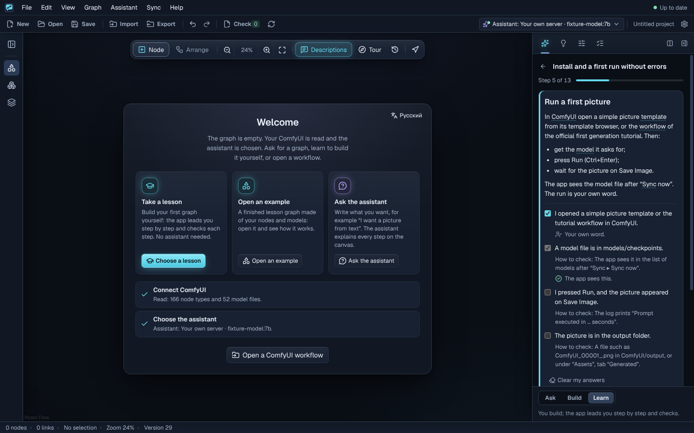

A checklist step asks about things done outside the app. An item the app can read says "The app sees this"; your tick
says "Your own word".

## 16 What a lesson ends with

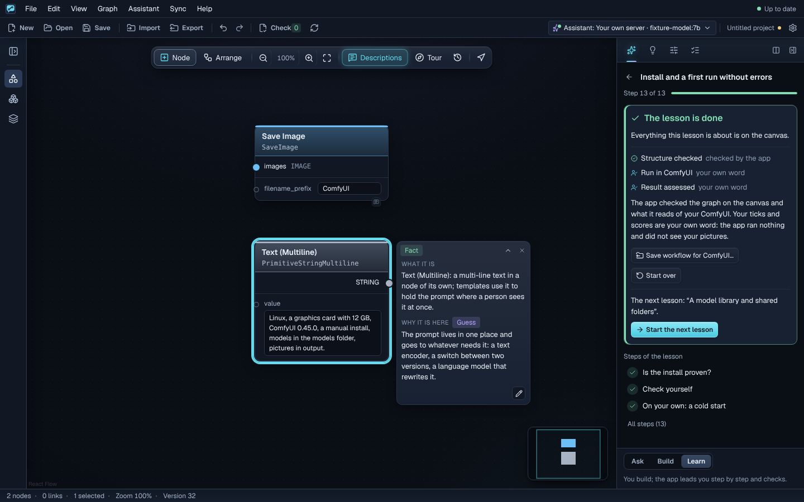

A lesson ends with up to three outcomes: structure checked, run in ComfyUI and result assessed, each with who stands
behind it. The app runs nothing in ComfyUI and does not see your pictures.
