[English](README.md)

# Снимки экрана

Снимки получены в настоящем интерфейсе с тестовыми данными, без пользовательских файлов. Обзорные кадры 01–16 показывают оформление версии 1.1.0; новые возможности описаны в текущем руководстве.

## 1.2.8: мастер решения проблемы на телефоне

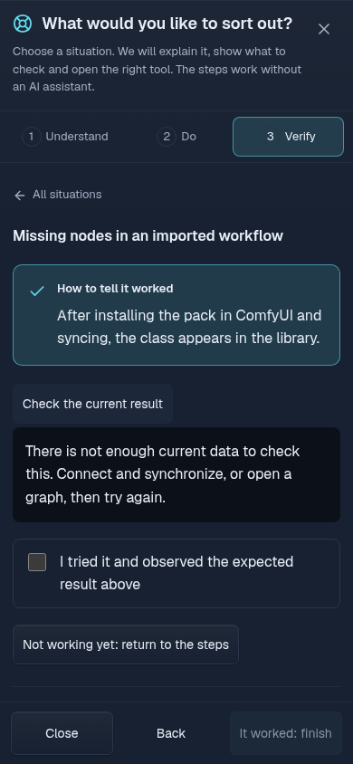

Мастер разделяет объяснение, действия и проверку результата. Если текущих данных недостаточно, он прямо сообщает об этом. Интерфейс этого кадра на английском; те же шаги доступны на русском.

## 01 Первый запуск

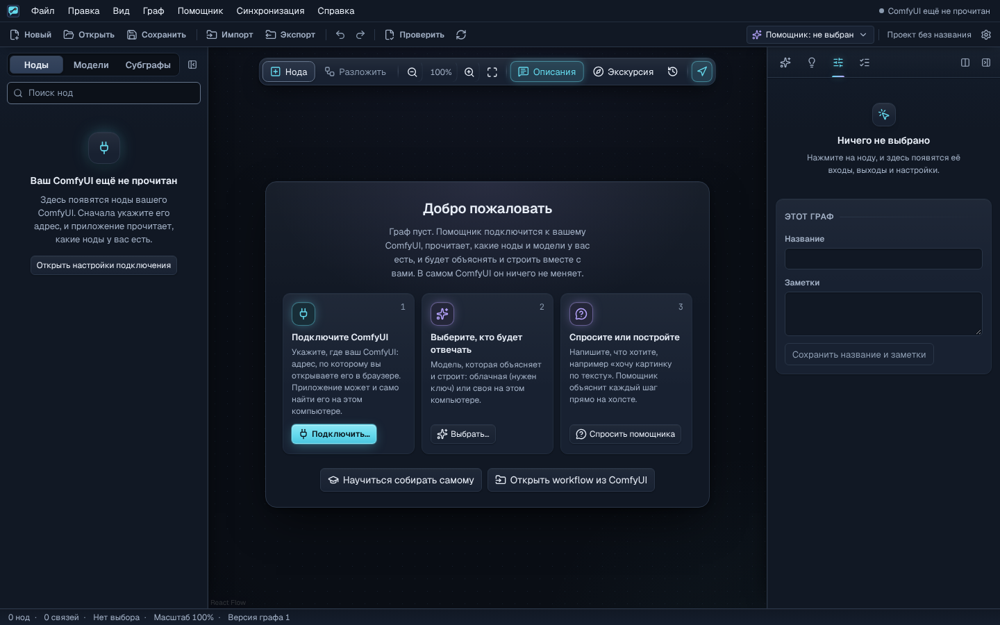

Новый человек видит три шага (подключить ComfyUI, выбрать, кто отвечает, спросить или построить) и что нужно для каждого.

## 02 Граф с объяснением

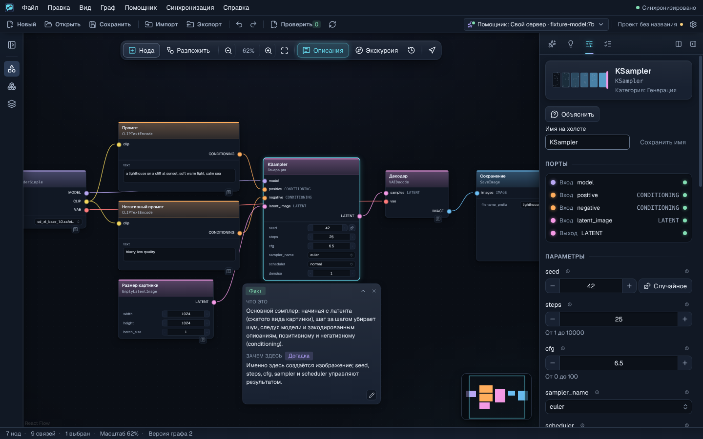

Выберите любую ноду, и приложение скажет, что это и зачем она здесь, и покажет её входы, выходы и настройки.

## 03 Библиотека

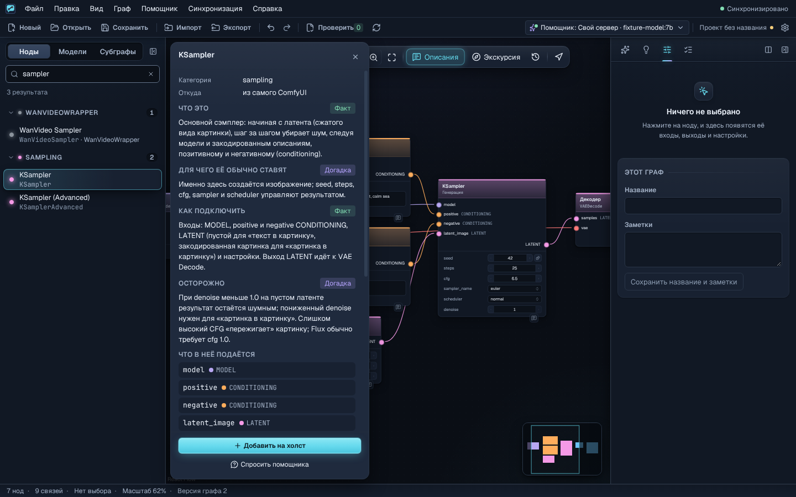

В библиотеке только те ноды и модели, что есть в вашем ComfyUI; карточка объясняет ноду до того, как вы её добавите.

## 04 Спросить помощника

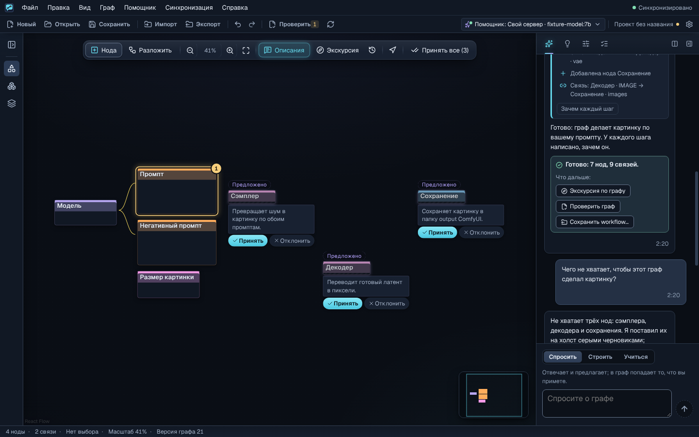

В режиме «Объяснить» помощник предлагает серые черновики, которые можно принять. В обычном режиме «Помощник» он также может сразу выполнять запрошенные правки графа.

## 05 Строить с помощником

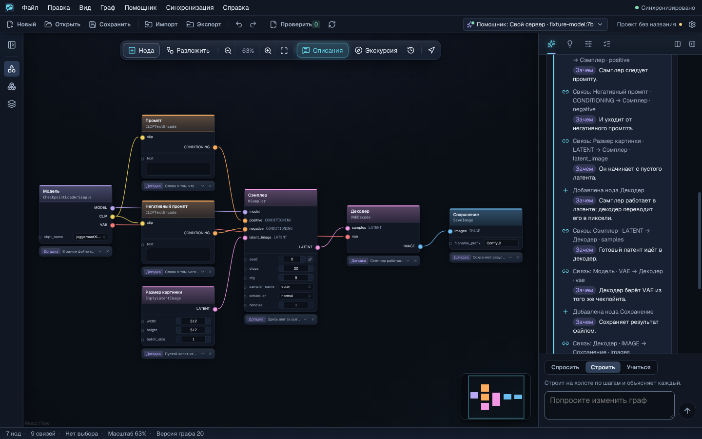

В режиме «Строить» помощник добавляет по одной ноде или связи и у каждого шага пишет, зачем он.

## 06 Уроки

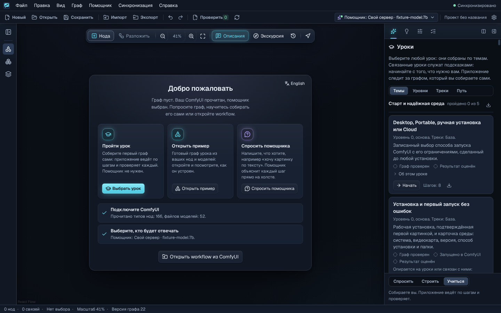

95 встроенных уроков в шестнадцати группах; модель им не нужна: вы собираете граф руками, а приложение проверяет
каждый шаг на холсте. На карточке видны уровень урока, его треки и то, чем он заканчивается.

## 07 Шаг урока

Шаг говорит, что сделать и зачем, а «Показать, где это» подсвечивает нужный выход и вход на холсте.

## 08 Проверка

Проверка сравнивает граф с установленными нодами и моделями и до экспорта говорит, чего не хватает.

## 09 Внутри субграфа

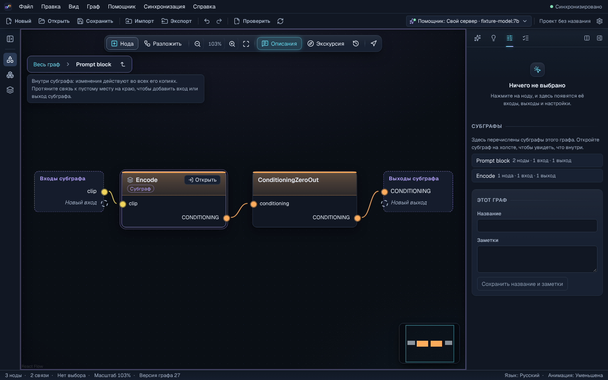

Субграф открывается на холсте; его входы и выходы стоят по краям.

## 10 Большой workflow

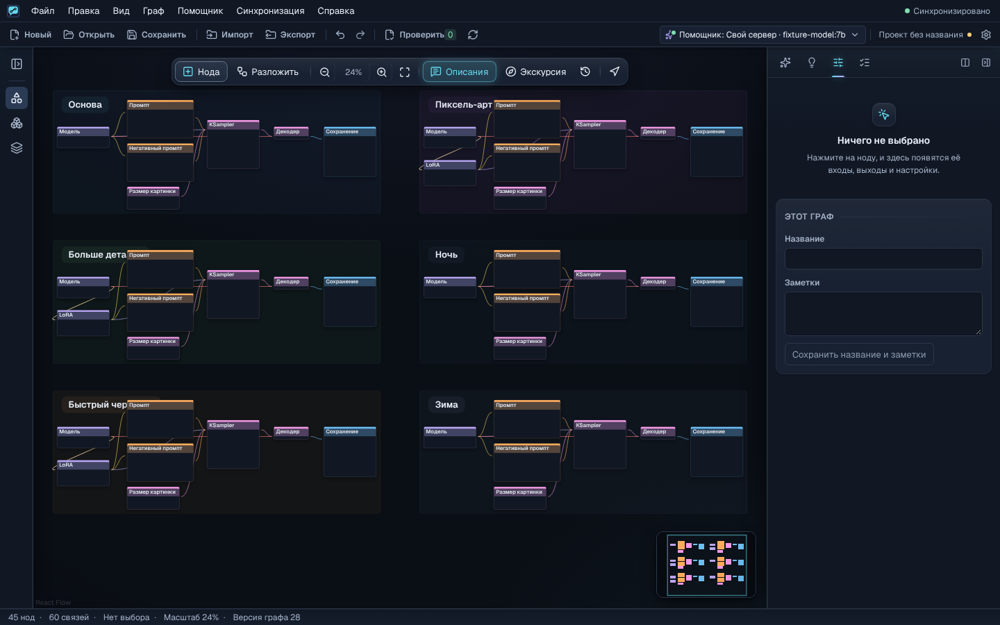

Большой workflow виден сверху понятными блоками; приблизьте, чтобы увидеть каждое поле.

## 11 Настройки: подключение

Синхронизация читает каталог ComfyUI, сохраняя модели, расширения и очередь. Выбранный вами медиафайл явно загружается в input.

## 12 Настройки: помощник

Облачная модель с вашим ключом или модель на вашем компьютере; уроки работают без обеих.

## 13 Справка

Руководство встроено в приложение и открывается из меню «Справка», в том числе без интернета.

## 14 Уроки как путь

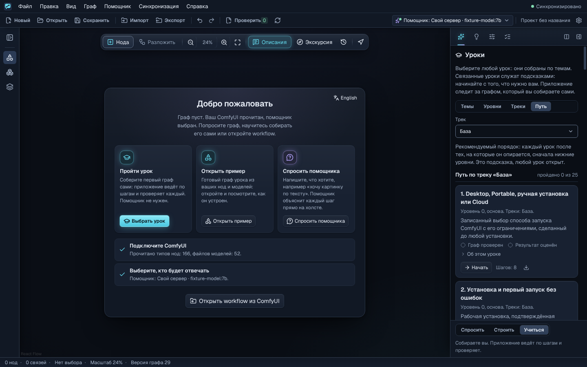

Список уроков можно читать по темам, уровням, трекам или как путь: рекомендуемый порядок для одного трека, с
номерами. Любой урок остаётся открытым.

## 15 Шаг, на который отвечаете вы

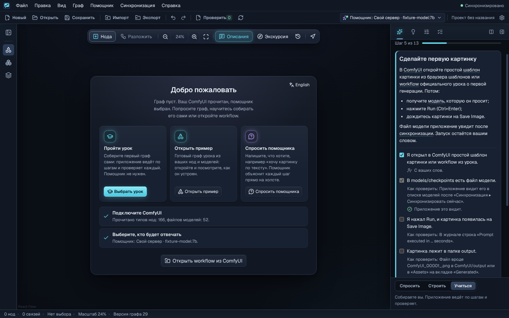

Шаг-список спрашивает о том, что делается вне приложения. Пункт, который приложение может прочитать, помечен
«Приложение это видит»; ваша отметка помечена «С ваших слов».

## 16 Чем заканчивается урок

Урок заканчивается тремя итогами: граф проверен, запущено в ComfyUI, результат оценён, и у каждого сказано, кто за
ним стоит. Приложение ничего не запускает в ComfyUI и не видит ваших картинок.
