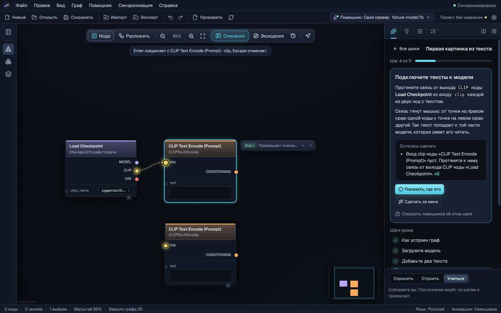
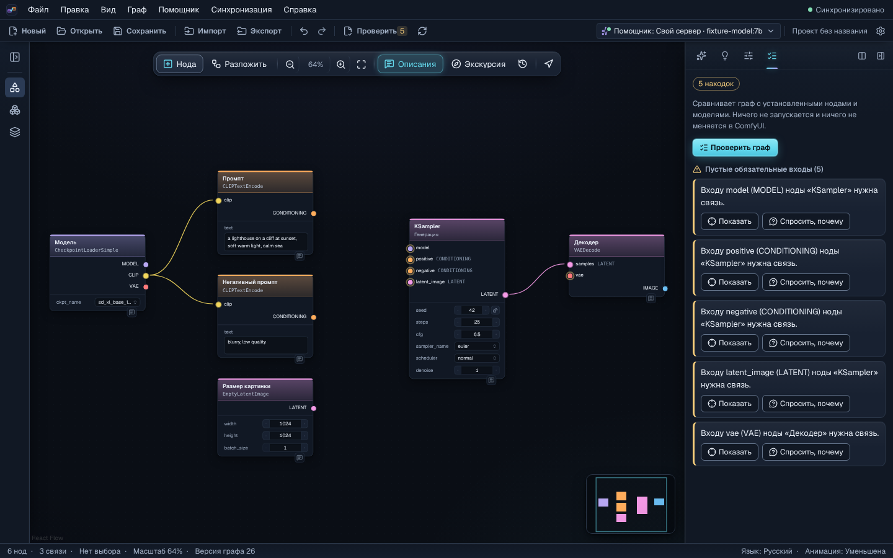
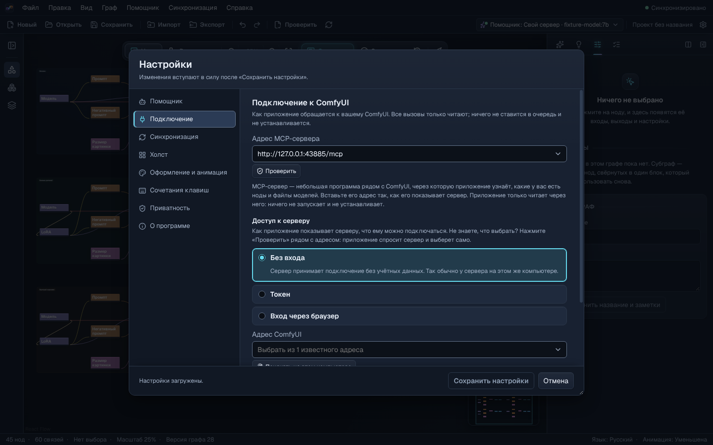
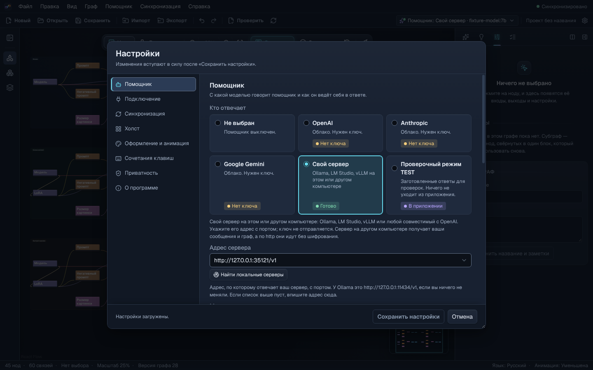
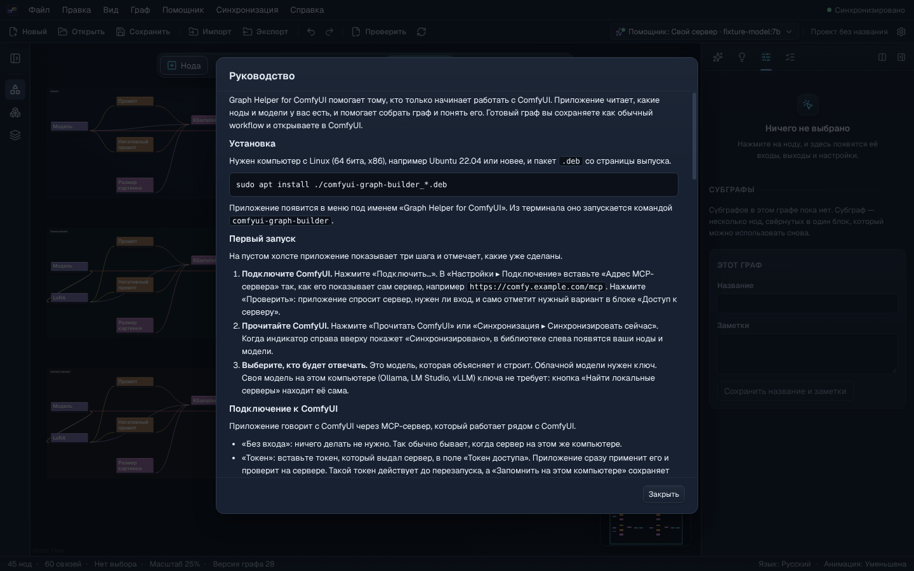

[English](README.md)

# Снимки экрана

Каждый снимок сделан в самом приложении командой `npm run shots:public`, только на тестовых данных: тестовый
сервер ComfyUI и помощник с заготовленными ответами, никаких чужих файлов. Окно 1440 x 900.

## 01 Первый запуск

Новый человек видит три шага (подключить ComfyUI, выбрать, кто отвечает, спросить или построить) и что нужно для каждого.

## 02 Граф с объяснением

Выберите любую ноду, и приложение скажет, что это и зачем она здесь, и покажет её входы, выходы и настройки.

## 03 Библиотека

В библиотеке только те ноды и модели, что есть в вашем ComfyUI; карточка объясняет ноду до того, как вы её добавите.

## 04 Спросить помощника

Помощник предлагает ноды серыми черновиками; в граф попадает только то, что вы приняли.

## 05 Строить с помощником

В режиме «Строить» помощник добавляет по одной ноде или связи и у каждого шага пишет, зачем он.

## 06 Уроки

Встроенным урокам модель не нужна: вы собираете граф руками, а приложение проверяет каждый шаг на холсте.

## 07 Шаг урока

Шаг говорит, что сделать и зачем, а «Показать, где это» подсвечивает нужный выход и вход на холсте.

## 08 Проверка

Проверка сравнивает граф с установленными нодами и моделями и до экспорта говорит, чего не хватает.

## 09 Внутри субграфа

Субграф открывается на холсте; его входы и выходы стоят по краям.

## 10 Большой workflow

Большой workflow виден сверху понятными блоками; приблизьте, чтобы увидеть каждое поле.

## 11 Настройки: подключение

Приложение только читает ComfyUI: ничего не устанавливает, не ставит в очередь и не меняет.

## 12 Настройки: помощник

Облачная модель с вашим ключом или модель на вашем компьютере; уроки работают без обеих.

## 13 Справка

Руководство встроено в приложение и открывается из меню «Справка», в том числе без интернета.
